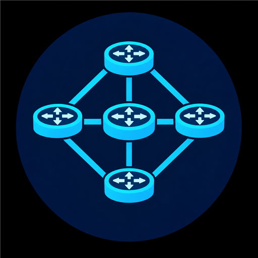

# 🛰️ PowerOSPF

<p align="center"></p>

[](https://www.powershellgallery.com/packages/PowerOSPF)
[](https://github.com/erikgraa/PowerOSPF/actions/workflows/tests.yml)
Pure-PowerShell, dependency-free **lab test tool** that speaks just enough **OSPFv2** (RFC 2328) and **BFD** (RFC 5880) to peer with real routers
(Cisco, MikroTik, FRR, NSX, ...) and lets you hand-craft packets as `byte[]`. Modelled on [PowerBGP](https://github.com/erikgraa/PowerBGP).

> ⚠️ **Lab use only.** This module forms real adjacencies, floods LSAs and can inject malformed packets and
> deliberately wrong timers into a live network. Never point it at production routers. It is not a routing daemon:
> it does not install routes, and it floods only to its own neighbors on a single interface.

**Requirements:** PowerShell 7.4+. OSPFv3, virtual links, stub/NSSA areas and a web UI are out of scope.

> 🔐 **Elevation required.** OSPF is IP protocol 89, so the module opens a *raw socket*. Run PowerShell as **Administrator** on Windows
> (and allow protocol 89 / multicast 224.0.0.5-6 through the firewall) or as **root** (or with `CAP_NET_RAW`) on Linux. BFD uses plain UDP 3784 and needs no elevation.  Raw receive on Windows is less reliable than on Linux; if you see no packets, try Linux/WSL2 with a bridged interface.

## 🚀 Quick start

```powershell
Import-Module ./PowerOSPF.psd1

# Join area 0 on 10.0.0.0/24 as 10.0.0.9 and advertise a stub network and an external route
Start-OspfSession -Name lab -RouterId 10.0.0.9 -LocalAddress 10.0.0.9 -PrefixLength 24 `
    -Prefix 192.168.9.0/24 -ExternalPrefix 172.31.0.0/16 -PassThru

Get-OspfNeighbor lab            # Init -> 2-Way -> ExStart -> Exchange -> Loading -> Full
Get-OspfLsa lab                 # the link-state database
Get-OspfRoute lab               # SPF result: intra-area, inter-area, external
Get-OspfEvent lab | Select-Object -Last 10

Send-OspfLsa lab -Type External -Prefix 10.99.0.0/24 -Metric 20 -ExternalType 1
Send-OspfLsa lab -Type External -Prefix 10.99.0.0/24 -Withdraw

Stop-OspfSession lab            # goodbye Hello; add -Silent to let the peer's dead timer expire
Remove-OspfSession lab
```

Authentication: `-AuthType None|Simple|Md5 -AuthKey secret -KeyId 1`. Point-to-point links: `-NetworkType PointToPoint`.

### Fault injection

```powershell
Set-OspfSession lab -SuppressHellos $true              # stop hellos; the peer's dead timer fires
Set-OspfSession lab -HelloInterval 3 -DeadInterval 7   # timer mismatch: the peer rejects our Hellos
Set-OspfSession lab -Mtu 9000                          # MTU mismatch: DBDs stay stuck in ExStart
Set-OspfSession lab -CorruptChecksum $true             # every packet fails verification
Set-OspfSession lab -Priority 0                        # become ineligible for DR
Update-OspfSession lab -ResetNeighbors                 # tear adjacencies back to ExStart
Send-OspfMessage lab ([byte[]](1,2,3))                 # arbitrary bytes straight onto the wire
```

### BFD (drives OSPF neighbor liveness)

```powershell
Start-BfdSession -Name bfd1 -Peer 10.0.0.1 -LocalAddress 10.0.0.9 -DesiredMinTxInterval 300000 `
    -AuthType MeticulousKeyedSha1 -AuthKey secret
Start-OspfSession -Name lab -RouterId 10.0.0.9 -LocalAddress 10.0.0.9 -BfdSession bfd1   # BFD Down kills the neighbor at once
Set-BfdSession bfd1 -SuppressTx $true                                                    # simulate a dead forwarding path
Reset-OspfNeighbor lab -Address 10.0.0.1 -Reason 'External down' -HoldDown 30            # manual equivalent
```
### Packet crafting only

```powershell
$h = New-OspfHello -RouterId 10.0.0.9 -AreaId 0.0.0.0 -NetworkMask 255.255.255.0 -Neighbor 10.0.0.1
$h | Format-Packet                 # hex dump to compare with Wireshark
ConvertFrom-OspfMessage $h         # parse it back

$lsa = New-OspfLsa -Type External -AdvertisingRouter 10.0.0.9 -LinkStateId 10.99.0.0 -Mask 255.255.255.0 -Metric 20
New-OspfLsUpdate -RouterId 10.0.0.9 -Lsa $lsa | ConvertFrom-OspfMessage

New-Packet -LengthField Len -Field @(
    New-PacketField Len  0 -Bytes 2
    New-PacketField Type 7 -Bytes 1
    New-PacketField Data 'DEADBEEF'
)
```

`New-PacketField` / `New-Packet` are generic: integers are big-endian, hex strings become raw bytes, and a length field can be filled in automatically.
Builders return a `byte[]` without IP header; `ConvertFrom-OspfMessage -HasIpHeader` parses bytes captured from a raw socket.

## 🐳 Container

A prebuilt image is published to GHCR on every release and relevant change merged to `main` (amd64, arm64). Main builds use `nightly`, `nightly-YYYYMMDDHHmmss` (UTC), and `sha-<full commit SHA>`; release builds keep their existing version, major/minor, and `latest` tags. Manual builds retain `dispatch` and are smoke-test-only unless pushing is explicitly selected. Pull requests build and smoke-test without publishing. Module sources/manifests, examples, tools, `Containerfile`, `.dockerignore`, and the container workflow trigger main builds; Markdown-only changes do not.

```powershell
podman run -it --rm --network host --cap-add NET_RAW ghcr.io/erikgraa/powerospf:latest
```

Host networking lets sessions reach lab devices directly; raw IP protocol 89 needs root (the image default) or `CAP_NET_RAW`. Build locally with `podman build -f Containerfile -t powerospf .`.

`Container retention` runs daily at 03:17 UTC and after successful main publication. It deletes only versions whose **every tag** is a recognized dated nightly or SHA tag, with both creation and last-update timestamps older than 30 days (dated tags must also be older). `latest`, `nightly`, `dispatch`, every release tag, unknown/malformed tags, recent versions, and all untagged versions are preserved. Child/subject manifests referenced by any tagged image, including nested multiarchitecture indexes and attestations, are protected. Untagged storage can therefore accumulate; this intentionally avoids unsafe manifest garbage collection.

Cleanup uses the user-owned `powerospf` package REST API and GHCR with `GITHUB_TOKEN` (`packages: write`); the repository must have package admin access for deletion. API, pagination, or manifest errors fail closed before deletion. It rechecks the full inventory and each candidate, and shares a non-cancelling concurrency group with builds. GitHub deletion is not transactional: external publishers should use the same coordination, and a failure stops remaining deletions without undoing earlier ones.

For a non-destructive inspection, run **Container retention → Run workflow** with `apply` left false, or set `GH_TOKEN` to a package-readable token and run `./tools/Remove-OldContainerVersion.ps1`. `-Apply` explicitly enables deletion. Safety fixtures run with the existing Pester suite and before scheduled cleanup; no live deletion is needed to test the policy.

## 🧰 Cmdlets

| Area | Cmdlets |
| --- | --- |
| Packet builder | `New-PacketField`, `New-Packet`, `Format-Packet` |
| OSPF packets | `New-OspfHello`, `New-OspfDbd`, `New-OspfLsRequest`, `New-OspfLsUpdate`, `New-OspfLsAck`, `ConvertFrom-OspfMessage` |
| LSAs | `New-OspfLsa`, `New-OspfRouterLink`, `ConvertFrom-OspfLsa` |
| OSPF sessions | `Start-OspfSession`, `Get-OspfSession`, `Set-OspfSession`, `Update-OspfSession`, `Stop-OspfSession`, `Resume-OspfSession`, `Remove-OspfSession` |
| BFD | `New-BfdControl`, `ConvertFrom-BfdControl`, `Start-BfdSession`, `Get-BfdSession`, `Set-BfdSession`, `Stop-BfdSession`, `Resume-BfdSession`, `Remove-BfdSession` |
| Inspect / inject | `Get-OspfNeighbor`, `Reset-OspfNeighbor`, `Get-OspfLsa`, `Get-OspfRoute`, `Get-OspfEvent`, `Send-OspfLsa`, `Send-OspfMessage`, `Export-OspfConfig` |

## ✅ What is implemented

- Packets: Hello, DBD, LSR, LSU, LSAck; null, simple-password and cryptographic (MD5) authentication.
- Neighbor state machine (Down, Init, 2-Way, ExStart, Exchange, Loading, Full), DD master/slave negotiation, retransmission, SeqNumberMismatch/BadLSReq restarts, inactivity and wait timers.
- DR/BDR election (RFC 2328 9.4) on broadcast networks; point-to-point networks.
- BFD (RFC 5880) control packets, session state machine, simple/keyed MD5/meticulous MD5/keyed SHA-1/meticulous SHA-1 authentication; BFD Down forces the linked OSPF neighbor Down.
- LSDB with Router, Network, Summary (type 3/4) and AS-External LSAs, Fletcher checksums, LSA comparison, MaxAge flushing, own-LSA sequence defense and refresh.
- SPF with next-hop resolution, inter-area and E1/E2 external routes.

Known simplifications: single interface per session; LSUs are flooded unicast to each neighbor instead of multicast; acknowledgments are immediate (not delayed); no stub/NSSA, virtual links or demand circuits; BFD echo and demand modes are not implemented; one BFD session per local address.

## 🧪 Tests

```powershell
Invoke-Pester ./Tests
```

Tests need no network: they cover packet round-trips, checksums, authentication, DR election, the neighbor state machine and LSDB exchange between two in-memory routers, SPF and BFD.

## License

See [LICENSE](LICENSE).
